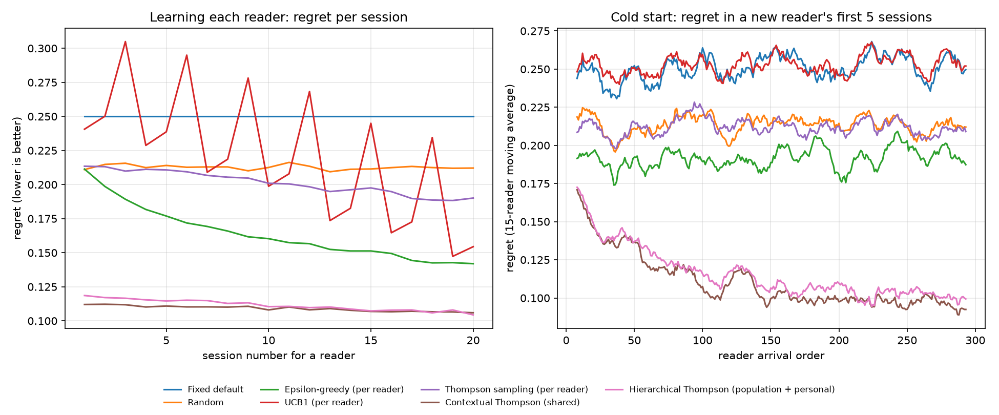

# Reading Buddy

[](https://github.com/vaeshnavi0718/reading-buddy/actions/workflows/ci.yml)

**[Try the interactive demo →](https://vaeshnavi0718.github.io/reading-buddy/)** Watch the bandit learn a simulated reader's best settings, or be the reader yourself.

Four years ago I tried to build a learning buddy for people with dyslexia: take a photo of a page, and it helps you read it. I couldn't finish it. This is the rebuild, starting with the part I find most interesting: **learning which reading settings work best for each person.**

Readers differ. A dyslexia-friendly font, wider spacing, shorter chunks of text or slower read-aloud can help one reader and slow down another. Most reading apps show everyone the same defaults. Reading Buddy treats choosing settings as a **contextual bandit** problem: try settings, observe whether the reader understood the text, and shift toward what works, without wasting many sessions on bad settings.

> **Honest scope:** this is a simulation. There are no real users yet, and nothing here is a claim about helping real readers learn. The simulated readers' preferences are assumptions (listed below), and the results depend on them.



## The problem

- **Settings (arms):** font (standard / dyslexia-friendly) × spacing (normal / wide) × chunking (full page / short chunks) × read-aloud speed (0.8x / 1.0x / 1.2x) = **24 combinations**.
- **Context the app can see:** decoding difficulty, whether the reader is confident, whether they read on a phone.
- **Reward:** 1 if the reader passes a short comprehension check after the session, else 0.
- **Regret:** how much lower the chosen settings' success probability is than that reader's best settings. Zero means the strategy chose that reader's best. Measured on probabilities, so it scores the choice, not the luck of the coin flip.

## Strategies compared

| Strategy | Idea |
|---|---|
| Fixed default | Same settings for everyone (what most apps do) |
| Random | A random setting each session |
| ε-greedy (per reader) | Mostly the best-so-far setting, sometimes a random one |
| UCB1 (per reader) | Pick the setting whose success rate could plausibly be highest |
| Thompson sampling (per reader) | Beta belief per setting; sample, pick the best sample |
| **Contextual Thompson (shared)** | Bayesian linear model over (setting × context) features, learned across all readers |
| **Hierarchical Thompson** | The shared model's prediction is the starting belief for a small per-reader model that personalizes |

## Results

300 simulated readers arriving one after another, 20 random seeds (mean ± standard deviation across seeds). If every reader always got their own best settings, the success rate would be **70.4%**.

**20 sessions per reader**

| Strategy | Regret per reader | Less regret than default | Success, first 5 sessions | Success, last 5 sessions |
|---|---|---|---|---|
| Fixed default | 5.00 ± 0.17 | — | 45.4% | 45.4% |
| Random | 4.25 ± 0.09 | 15% | 49.1% | 49.2% |
| ε-greedy (per reader) | 3.28 ± 0.10 | 35% | 51.3% | 56.0% |
| UCB1 (per reader) | 4.41 ± 0.10 | 12% | 45.1% | 52.9% |
| Thompson (per reader) | 4.02 ± 0.08 | 20% | 49.2% | 51.4% |
| **Contextual Thompson (shared)** | **2.18 ± 0.15** | **56%** | **59.3%** | **59.8%** |
| Hierarchical Thompson | 2.23 ± 0.17 | 55% | 58.8% | 59.7% |

**60 sessions per reader** (`python run.py --sessions 60`)

| Strategy | Regret per reader | Less regret than default | Success, last 5 sessions | Near-best settings, last 5 sessions |
|---|---|---|---|---|
| Fixed default | 15.01 ± 0.51 | — | 45.4% | 3.9% |
| ε-greedy (per reader) | 8.14 ± 0.20 | 46% | 59.5% | 22.2% |
| Contextual Thompson (shared) | 5.63 ± 0.33 | 62% | 61.4% | 29.9% |
| **Hierarchical Thompson** | **5.60 ± 0.22** | **63%** | **62.0%** | **33.1%** |

## What I learned

1. **Learning each reader from scratch barely works at this scale.** 24 combinations and 20 sessions means a per-reader strategy can't even try everything once. UCB1's zigzag in the plot is it cycling through untried options.
2. **Learning across readers solves the cold start.** The contextual strategies start a brand-new reader at about 59% success instead of 45%, and the right-hand plot shows their first-session regret falling as more readers arrive: later readers benefit from earlier ones.
3. **Personalization pays off only with history.** Within 20 sessions the hierarchical model is no better than the shared one. Over 60 sessions it ends slightly ahead (33.1% vs 29.9% of late sessions at near-best settings). Personal quirks are subtle, and 20 pass/fail results aren't enough to learn them.
4. **Per-reader Thompson sampling lost to ε-greedy here.** With 24 arms and flat priors, it keeps exploring settings it has barely tried, a cost that matters when sessions are scarce.

### Two bugs worth recording

- **A greedy population model.** The first hierarchical version built each reader's starting belief from the population model's *mean*. Thompson sampling explores by *sampling*, so the population model stopped exploring. The tell: shrinking the personal model to almost nothing should have reproduced the shared model, but scored 3.24 vs 2.09. Sampling the population model fixed it (2.14 vs 2.09).
- **A prior on the wrong scale.** The per-reader model predicts success *probabilities*, but its first prior allowed readers to differ by ±50 percentage points, so two noisy sessions erased what the population knew. The spread was tuned to ±5 points **on held-out seeds 100–104**; every reported number uses seeds 0–19.

## Assumptions in the simulated readers

Chosen to be plausible, not measured (`buddy/readers.py`):

- Readers with decoding difficulty do better with a dyslexia-friendly font, wide spacing and slower speech, and worse with fast speech.
- Less confident readers do better with short chunks; confident readers prefer full pages and faster speech.
- Short chunks help on a phone; wide spacing costs a little there.
- Every reader also has personal quirks (random deviations), so the population pattern alone never finds everyone's best settings.

If these assumptions are wrong, the numbers change. The useful takeaways are the patterns (cold start, when personalization pays off), not the exact percentages.

## Run it

```
python3 -m venv .venv && .venv/bin/pip install -r requirements.txt
.venv/bin/python run.py                 # 300 readers x 20 sessions x 20 seeds (~1 min)
.venv/bin/python run.py --sessions 60   # longer horizon
.venv/bin/python -m pytest -q           # tests
```

## Layout

```
buddy/settings.py     the 24 setting combinations and their features
buddy/readers.py      simulated readers and every assumption about them
buddy/strategies.py   the 7 strategies
buddy/experiment.py   runs strategies on identical readers, computes regret
run.py                experiment, results table, plots
tests/                strategies learn an obvious best setting, beat the default, regret never negative
docs/                 the interactive demo (GitHub Pages): a browser port of the simulator and Thompson sampling
```

## What's next

The rest of the original idea: photograph a page, extract its text (comparing Tesseract with a vision model on accuracy), show it in a dyslexia-friendly reader with word-by-word read-aloud (building on [read-to-me](https://github.com/vaeshnavi0718/read-to-me)), and put this bandit behind the settings. And, most importantly, feedback from real readers with dyslexia before claiming it helps anyone.
